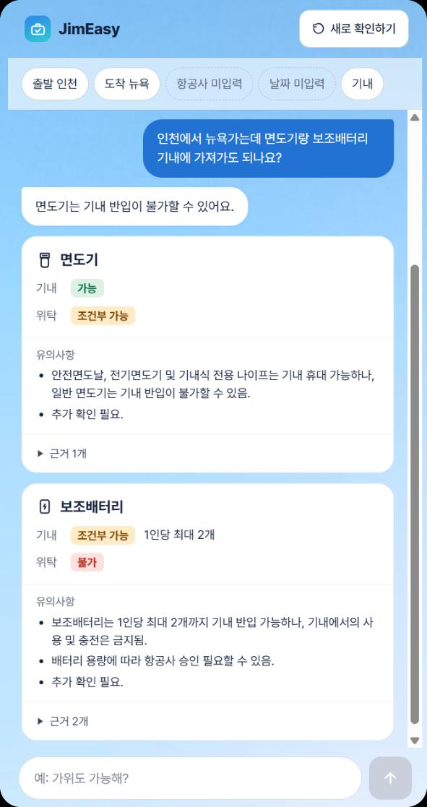

# 짐이지 (JimEasy) · 프론트엔드

**"이 물건 비행기에 가져가도 돼?"를 대화로 묻고, 물품별 기내·위탁 판정과 근거를 카드로 보여 주는 챗봇 화면입니다.**
짐이지 백엔드의 `/chat` API를 호출하며, 서버 없이 화면만 확인할 수 있는 예시 응답 모드도 있습니다.

<p align="center">
  
  <br><sub>실제 백엔드에 연결해 실행한 화면(2026년 11월 발표 시점). 답변은 예시이며 공식 안내가 아닙니다.</sub>
</p>

| 레포 | 역할 |
|---|---|
| [jimeasy-backend](https://github.com/CARRY-CHECK/jimeasy-backend) | 질의 구조화, 규정 검색(Hybrid + 재정렬), 근거 기반 판정, 대화 API |
| **[jimeasy-frontend](https://github.com/CARRY-CHECK/jimeasy-frontend)** | **채팅 화면(React + Vite), 판정 카드와 추가 질문 UI** |

두 레포는 HTTP API로만 연결됩니다.

- React 18 + Vite, JavaScript, 일반 CSS
- 글꼴: [Pretendard](https://github.com/orioncactus/pretendard) (npm 패키지로 포함)
- 모바일 기준 화면입니다. 노트북에서는 가운데에 휴대폰 프레임으로 보입니다.

## 빠른 시작

Node.js 20 이상이 필요합니다.

```bash
git clone https://github.com/CARRY-CHECK/jimeasy-frontend.git && cd jimeasy-frontend
npm ci
cp .env.example .env.local   # Windows: copy .env.example .env.local
npm run dev                  # http://localhost:5173
```

백엔드 없이 화면만 보려면 `.env.local`에서 `VITE_MOCK=1`로 바꿉니다. 예시 응답은 `src/mock.js`에 있으며 출처와 판정 문구는 모두 가상입니다.

| 변수 (`.env.local`) | 설명 |
|---|---|
| `VITE_API_URL` | 백엔드 주소. 기본 `http://localhost:8000` |
| `VITE_MOCK` | `1`이면 서버 없이 예시 응답으로 동작 |

### 백엔드와 함께 실행

[백엔드 레포](https://github.com/CARRY-CHECK/jimeasy-backend#빠른-시작-합성-샘플)의 빠른 시작대로 설치한 뒤 API 서버를 켭니다. 백엔드 CORS가 `http://localhost:5173`을 허용하므로 개발 서버 포트는 5173으로 고정했습니다(`vite.config.js`).

```bash
# 백엔드 레포 루트에서
python -m uvicorn app.api.main:app --port 8000
```

서버는 시작할 때 임베딩·재정렬 모델을 불러오므로 준비까지 최대 1분 정도 걸립니다. 그동안 화면에는 "서버를 준비하고 있어요"가 나옵니다(`/openapi.json`으로 확인).

## 화면 흐름

1. 첫 인사 말풍선이 하나씩 나옵니다.
2. 질문하면 백엔드 응답을 기다리는 동안 점 세 개가 움직입니다.
3. 정보가 부족하면 백엔드가 `clarification`(최대 3개)을 보냅니다. 화면에서는 **하나씩** 묻고, 답을 다 모으면 `질문 답` 줄로 이어 한 번에 보냅니다. 질문이 하나뿐이면 선택지 클릭을 `choice`로 보냅니다.
4. 판정이 오면 요약 → 물품 카드 순서로 하나씩 보여 줍니다. 카드에는 기내·위탁 판정, 짧은 조건, 설명, 근거 목록이 있습니다. 이전 답변의 카드는 흐리게 표시됩니다.
5. 상단 여행 조건 칩을 누르면 조건을 고쳐 다시 확인할 수 있습니다(바뀐 칸만 문장으로 전송, 지운 칸은 "미정").
6. 오류가 나면 백엔드가 보낸 `detail`을 그대로 말풍선에 보여 줍니다. 예: `대화 모델 요청 실패 (HTTP 429).`는 OpenAI 요청 한도, `대화 처리 호출 상한에 도달했습니다`는 백엔드의 호출 상한 초과입니다.

## 폴더 구조

```
src/
  App.jsx            화면 상태(phase)와 대화 흐름, 응답을 하나씩 보여 주는 단계 처리
  api.js             /chat, /chat/reset 호출과 서버 확인(ping)
  mock.js            VITE_MOCK=1일 때 쓰는 예시 응답(가상 출처)
  styles.css         전체 스타일 (색·간격은 디자인 시안 값)
  components/
    Header.jsx       로고, 새로 확인하기
    TripBar.jsx      여행 조건 칩과 수정 칸
    ItemCard.jsx     물품 카드, 제한 없는 물품 묶음 카드, 근거 목록
    Bubbles.jsx      서버 준비 중 / 기다리는 중 / 오류 말풍선
    Composer.jsx     입력창
    icons.jsx        선 아이콘(SVG)
public/
  carrycheck_front.jpg   배경 그라데이션 이미지 (styles.css의 --bg-image)
```

백엔드 응답 형식이 바뀌면 `App.jsx`의 `planSteps`와 `components/ItemCard.jsx`를 먼저 보면 됩니다. 응답 필드는 백엔드 레포의 [docs/api.md](https://github.com/CARRY-CHECK/jimeasy-backend/blob/main/docs/api.md)에 있습니다.

## 빌드

```bash
npm run build     # dist/에 정적 파일 생성
npm run preview   # 빌드 결과 미리 보기
```

## 한계

- 대화 세션은 백엔드 메모리에 있으므로 서버를 다시 켜면 대화가 초기화됩니다.
- 로그인·대화 기록 저장이 없습니다.
- 한국어 화면만 있습니다.

## 만든 사람들

[Chaewon-Leee](https://github.com/Chaewon-Leee)(이채원), [jiwoneight](https://github.com/jiwoneight)(정지원), [ginny0825](https://github.com/ginny0825)(김지은), [nickjjang7](https://github.com/nickjjang7)(옥석현). 자세한 명단은 [AUTHORS.md](AUTHORS.md)에 있습니다.

## 고지

- 학습·교육 목적의 비상업 프로젝트입니다. 화면 예시에 나오는 항공사·기관 이름은 입력 예시이거나 가상이며, 실제 항공사·공항·정부 기관과 관련이 없습니다.
- **짐이지의 답변은 공식 안내가 아닙니다.** 여행 전 이용 항공사·공항·정부의 공식 안내를 확인하세요.
- 글꼴 Pretendard는 SIL Open Font License 1.1을 따르며 npm 패키지로 설치됩니다.

## 라이선스

코드는 [MIT 라이선스](LICENSE)로 배포합니다.
